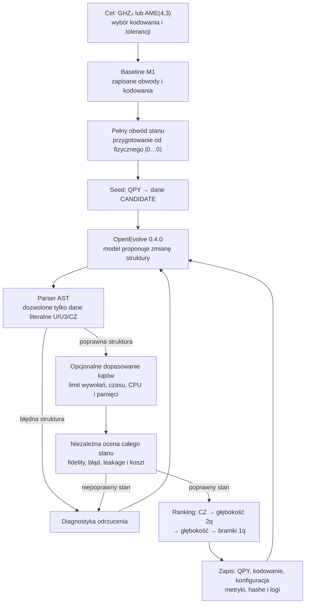
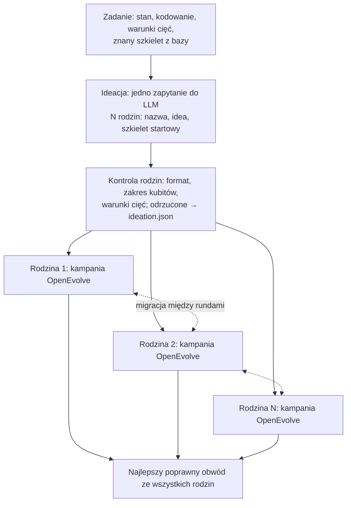

# Pipeline: synteza stanów quditowych

Stan dokumentu: 2 listopada 2026. Katalog roboczy: worktree `0c67`.

## Cel

Szukamy krótkich fizycznych obwodów kubitowych, które przygotowują zadany stan quditowy. Najpierw optymalizujemy stany grafowe GHZ₃ i AME(4,3), następnie przejdziemy do wyższych wymiarów. Stan grafowy `ghz3` z rejestru projektu jest lokalnie równoważny standardowemu GHZ₃.

Obecny priorytet to cały stan i cały obwód przygotowania. Osobny rejestr podstawowych bramek (M2.5) jest odłożony.

## Graf pipeline’u



Kandydat jest odczytywany jako dane: jego kod Python nie jest wykonywany. Poprawny stan zawsze ma wyższy wynik niż niepoprawny, niezależnie od liczby CZ. Po ocenie zapisany QPY jest wczytywany i sprawdzany ponownie.

## Co już działa

- **M1 — evaluator i baseline.** Wczytanie zapisanych F₃ i CZ₃, porównanie z istniejącą walidacją, odczyt i zapis QPY/NPY oraz raporty z hashami. Znaleziono rzeczywiste obwody CZ₃ z 5 CZ dla E* i dla kodowania mieszanego.
- **M2 — optymalizacja klasyczna.** Dopasowanie kątów stałej topologii CZ₃; seedy, limity, wyniki poszczególnych prób i wznowienie. Osobny solver dopasowuje wybrane kąty **pełnego obwodu stanu**; obecnie do 24 kątów i 200 wywołań solvera.
- **Benchmark pełnych stanów.** Fizyczny obwód obejmuje przygotowanie stanu początkowego. Dla AME(4,3) test potwierdza, że wszystkie sześć redukcji do dwóch qutrytów to `I₉/9`.
- **M3 — integracja OpenEvolve.** Wersja `0.4.0` jest przypięta w opcjonalnej zależności `evolution`. Działa ewolucja z ograniczonymi danymi kandydatów, osobnym procesem oceny, limitem zasobów i rankingiem najpierw według poprawności.
- **Test offline.** Dwa przebiegi użyły deterministycznej atrapy modelu, po jednej iteracji, bez dostępu do sieci. To test integracji, nie kampania z prawdziwym LLM. Atrapa zaproponowała usunięcie jednej CZ. Osobna diagnostyka sprawdziła też niepoprawne usunięcie innej CZ.
- **Testy.** Ostatni uruchomiony zestaw: 175 testów przeszło, w tym integracja z rzeczywistym OpenEvolve i atrapą modelu.

## Zweryfikowane wyniki

Poniższe obwody wykorzystują E* na wyjściu. Błąd to norma różnicy pełnych stanów po wyrównaniu jednej fazy globalnej. Leakage to końcowe prawdopodobieństwo poza przestrzenią kodową.

| Stan | Baseline E* | OpenEvolve + atrapa | Fidelity | Leakage | Błąd |
| --- | ---: | ---: | ---: | ---: | ---: |
| GHZ₃, stan grafowy | 10 CZ | **9 CZ** | 0,9999999999999991 | 4,10 × 10⁻³¹ | 1,14 × 10⁻¹⁵ |
| AME(4,3) | 20 CZ | **19 CZ** | 0,999999999999998 | 6,94 × 10⁻³¹ | 1,92 × 10⁻¹⁵ |

Przy porównaniu pełnych stanów z **bezpośrednim przygotowaniem** wariant kanoniczny miał odpowiednio 15 i 28 CZ. Wariant kanoniczny przygotowujący stan przez pełną F₃ miał 18 i 32 CZ. Przygotowanie przez F₃ oraz bezpośrednie przygotowanie to różne strategie; pierwsza realizuje całą bramkę, druga tylko stan potrzebny na wejściu.

Koszty obejmują przygotowanie od fizycznego zera. Nie obejmują końcowego dekodowania E*, pomiaru ani routingu do konkretnego urządzenia. Żaden z tych wyników nie jest dowodem minimum.

## Następne kroki

1. **Rozszerzyć testy offline M3.** Sprawdzić więcej kontrolowanych mutacji topologii i kątów, kilka seedów, limity oraz odporność na niepoprawne programy. Zachować porównanie z bazą 9 CZ i 19 CZ.
2. **Uruchomić krótką kampanię z prawdziwym LLM.** Najpierw ustalić konfigurację modelu oraz limit iteracji, czasu i kosztu API. Każdy kandydat przechodzi ten sam parser i niezależny evaluator. Płatne lub zewnętrzne wywołania wymagają osobnego polecenia.
3. **Optymalizować całe stany kolejno.** Dla GHZ₃, potem AME(4,3), porównać OpenEvolve z obecnymi zapisanymi wynikami. Zapisywać również nieudane próby i rzeczywiste QPY poprawnych finalistów.
4. **Uwzględnić odczyt i sprzęt.** Dodać osobne, zweryfikowane warianty z dekodowaniem, pomiarem i routingiem. Nie mieszać ich kosztów z obecnym kosztem samego przygotowania.
5. **Uogólnić na wyższe wymiary.** Rozszerzyć definicje docelowych stanów, kodowania i evaluator poza `d = 3`. Zacząć od `d = 4`, następnie `d = 5` i `d = 6`, z jawnymi limitami pamięci i czasu oraz pełną walidacją.
6. **Dodać optymalizację kodowania.** Po uzyskaniu działającej kampanii dla stałych kodowań porównać wybór kodowania z jego wspólną optymalizacją wraz z obwodem. Koszt zmian kodowania musi być jawny.

## Gdzie są pliki

- [Kod evaluatora stanów](../src/qudits_on_qubits/evolution/state_workloads.py), [solver stanów](../src/qudits_on_qubits/evolution/state_optimize.py).
- [Parser kandydatów](../src/qudits_on_qubits/evolution/oe_candidates.py), [evaluator OpenEvolve](../src/qudits_on_qubits/evolution/oe_evaluator.py), [uruchamianie OpenEvolve](../src/qudits_on_qubits/evolution/oe_run.py).
- [Benchmark pełnych stanów](../artifacts/evolution/state_workloads/run_20261102_01/README.md).
- [GHZ₃: raport M3](../artifacts/evolution/openevolve/ghz3_mock_20261102/summary.json) i [obwód 9 CZ](../artifacts/evolution/openevolve/ghz3_mock_20261102/best.qpy).
- [AME(4,3): raport M3](../artifacts/evolution/openevolve/ame43_mock_20261102/summary.json) i [obwód 19 CZ](../artifacts/evolution/openevolve/ame43_mock_20261102/best.qpy).
- Instrukcje odtworzenia znajdują się w plikach README poszczególnych przebiegów. Katalog `artifacts/` jest ignorowany przez Git. Prywatnych danych źródłowych z `notebooks/private/` nie należy publikować.

Do ostatniego testu pakiet OpenEvolve i jego zależności były dostępne tymczasowo w `/tmp/qoq-m3-deps`. `/tmp` nie jest trwałą instalacją; instrukcja instalacji opcjonalnej zależności znajduje się w README przebiegu M3.

## Testy offline i kampanie CLIProxy — 2 listopada 2026

Testy obejmują granice parsera i limitów, błędne programy, uszkodzone odpowiedzi procesu oraz mutacje CZ i kątów dla trzech seedów. Mutacje porównano z niezależnym wektorem stanu. Testy zapisanych wyników wymagają lokalnych, ignorowanych przez Git artefaktów 9 CZ i 19 CZ.

Dwie kampanie użyły CLIProxy, modelu `gpt-6.1-terra`, `reasoning_effort=high`, seeda 0 i jednej iteracji na stan. Punktem startowym były zapisane wyniki atrapy, a nie pierwotne obwody 10 i 20 CZ. Każdy zwycięski obwód został zapisany jako QPY, odczytany i ponownie sprawdzony.

| Stan | CZ przed → po | Głębokość przed → po | Bramki 1q przed → po | Tokeny |
| --- | --- | --- | --- | ---: |
| GHZ₃ | 9 → 9 | 23 → 22 | 54 → 51 | 6933 |
| AME(4,3) | 19 → 19 | 34 → 33 | 104 → 100 | 12359 |

Wyniki: [GHZ₃](../artifacts/evolution/openevolve/ghz3_terra_high_20261102/summary.json), [AME(4,3)](../artifacts/evolution/openevolve/ame43_terra_high_20261102/summary.json). Konfiguracja modelu nie zawiera klucza. Manifesty zachowują ścieżki `/tmp` z czasu wykonania; kopie danych wejściowych i konfiguracji znajdują się w katalogu `artifacts/evolution/openevolve`.

Wariant offline `state_readout.compile_readout` sprawdza dekodowanie do kodowania kanonicznego i routing na podanej mapie połączeń. Osobno raportuje koszt przygotowania, dekodowania i obwodu z pomiarem. Dla poprzednich wyników 9 i 19 CZ oraz symulowanego łańcucha uzyskano odpowiednio 39 i 86 CZ po dekodowaniu i routingu. Nie użyto kalibracji ani rzeczywistego backendu.

## Limit czasu i wykorzystanie Codex

Cały przebieg ma domyślny limit 900 sekund. Opcja `--campaign-timeout-seconds` zmienia limit. Na 120 s przed limitem (najwyżej 10% limitu) proces kampanii dostaje SIGTERM. OpenEvolve kończy wtedy pętlę i zwraca najlepszy program. Kampania zapisuje `best_program.py`, a gdy żaden kandydat nie jest poprawny, także `best_invalid.json` z metryk OpenEvolve (bez nowego dopasowania). Po przekroczeniu limitu proces kampanii i jego procesy potomne dostają SIGKILL. Katalog wyników może wtedy zawierać niepełne dane. `summary.json` i `manifest.json` powstają dopiero po walidacji zwycięskiego obwodu.

Opcja `--codex-auth-file ŚCIEŻKA` pokazuje wykorzystany i pozostały procent przed kampanią oraz po niej. Wskaż plik konta Codex używany przez CLIProxy, na przykład plik `codex-*.json` z katalogu `~/.cli-proxy-api`. Nie wklejaj jego zawartości do polecenia ani dokumentacji. Odczyt wysyła token z tego pliku bezpośrednio do `https://chatgpt.com/backend-api/wham/usage`; nie korzysta z API zarządzania proxy. Nie zapisuje tokenu, identyfikatora konta ani ścieżki do pliku w artefaktach.

Odczyt pokazuje limity wybranego konta, które mogą obejmować inne sesje. Jeżeli proxy użyje innego konta, odczyt nie opisuje zużycia tego konta. Niewygasły token i dostęp do sieci są wymagane. Gdy odczyt się nie powiedzie, kampania działa dalej i pokazuje, że dane są niedostępne. Limit czasu nie gwarantuje anulowania żądania, które dostawca już otrzymał.

## Harness CLI

Po instalacji projektu z opcją `evolution` polecenie `qoq-evolution menu` uruchamia tryb interaktywny. Polecenie `qoq-evolution run` uruchamia serię. Domyślnie obejmuje GHZ₃ i AME(4,3), seed 0 oraz atrapę offline. Każdy stan korzysta z osobnej zapisanej bazy. Podaj nowy katalog wyników:

```sh
qoq-evolution run --output artifacts/evolution/series/test --seed 0 --seed 1
```

Domyślne bazy znajdują się w ignorowanym przez Git katalogu `artifacts` worktree `0c67`. Uruchom komendę z katalogu repozytorium. Opcje `--state`, `--baseline-ghz3` i `--baseline-ame43` wybierają stany i bazy. Opcja `--model-config` włącza skonfigurowany model, a `--codex-auth-file` włącza odczyt limitu konta. Domyślny limit to 900 s na kampanię i 1800 s na serię. Opcje `--campaign-timeout-seconds` i `--series-timeout-seconds` zmieniają te limity. Harness przekazuje kampanii najwyżej czas pozostały do końca serii. Każda kampania zapisuje własne wyniki. Harness zapisuje postęp w `batch.json`, zatrzymuje serię po błędzie i nie nadpisuje istniejącego katalogu. Polecenia `baseline`, `classical`, `state-benchmark` i `campaign` przekazują argumenty do istniejących komend pipeline’u.

Dostępne opcje pokazuje `qoq-evolution run --help`. Bez instalacji użyj `python -m qudits_on_qubits.evolution.harness` z katalogiem `src` w `PYTHONPATH`.

Polecenie `qoq-evolution readout` tworzy osobny wariant z dekodowaniem i pomiarem na podanej mapie połączeń. Przykład łańcucha sześciu kubitów:

```sh
qoq-evolution readout --state ghz3 --circuit ŚCIEŻKA_DO_QPY --encoding ŚCIEŻKA_DO_NPY \
  --output NOWY_KATALOG --edge 0,1 --edge 1,2 --edge 2,3 --edge 3,4 --edge 4,5
```

Wynik obejmuje obwód dekodowany, obwód po routingu i metryki. Mapa połączeń nie zawiera kalibracji urządzenia.

## Optymalizacja pipeline’u — 3 listopada 2026

### Diagnoza poprzedniego przebiegu

Kampania `terra_10_20261102T231201Z` (10 iteracji, prawdziwy LLM) nie zmniejszyła liczby CZ: GHZ₃ 9 → 9, AME(4,3) 19 → 19. Przyczyny:

- **Brak dopasowania kątów.** Domyślnie `max_nfev=0`, a solver dopasowywał najwyżej 24 pierwsze kąty. Po usunięciu CZ LLM musiałby sam podać kąty z dokładnością 10⁻¹⁰. Pełne dopasowanie wszystkich kątów potwierdziło, że żadne pojedyncze usunięcie CZ z tych obwodów nie daje poprawnego stanu (najmniejszy błąd 0,29–0,36).
- **Stały seed LLM.** OpenEvolve wysyłał ten sam `seed` w każdym zapytaniu. Ten sam prompt dawał tę samą odpowiedź: 6 z 10 iteracji kończyło się błędem „Rewrite is identical”.
- **Brak sygnału dla LLM.** Prompt pokazywał tylko wynik z czterema cyframi (1,9629 dla wszystkich programów). Błędy oceny trafiały tylko do logu.
- **Koszt tokenów.** Każda iteracja przepisywała ~100 bramek z kątami (~3,7 tys. tokenów odpowiedzi, ~69 s). Prompt rósł z 8 do 16 tys. tokenów, bo zawierał kilka kopii obwodu.
- **Iteracje sekwencyjne i limit 10 iteracji.**

### Zmiany

- **Reprezentacja `skeleton`** (`--representation skeleton`). Kandydat to tylko uporządkowana lista par CZ (`{"num_qubits": W, "cz": [[a, b], ...]}`, jedna para na wiersz). Evaluator wstawia bramkę U na każdym kubicie na początku i na obu kubitach po każdym CZ. Następnie dopasowuje wszystkie kąty metodą Levenberga–Marquardta z dokładnym jakobianem i kilkoma restartami (`skeleton_fit.py`). Restart kończy się wcześniej, gdy błąd przestaje maleć. Restarty mają stały seed, więc wynik da się odtworzyć.
- **Wolne kodowania** (`--encoding-mode free`, tylko ze `skeleton`). Każdy qutryt może użyć dowolnej trójwymiarowej podprzestrzeni swoich dwóch kubitów. W trakcie obwodu wszystkie cztery poziomy bloku, także |11⟩, są dostępne. Tylko stan końcowy musi leżeć w wybranych podprzestrzeniach. Fit dodaje na każdym bloku pomocniczy ogon z 3 CZ (wystarcza dla dowolnej bramki dwukubitowej) i dopasowuje stan do kodowania kanonicznego. Ogon wyznacza kodowania `E_k`.
- **Jawny koszt odczytu** (`decoders.py`). Dla każdego poprawnego stanu, także przy stałym kodowaniu, evaluator szuka najkrótszego dekodera do kodowania kanonicznego: 0, 1 lub 2 CZ przez dopasowanie, w przeciwnym razie 3 CZ. Trzy CZ pochodzą z ogona dopasowania (dokładny z konstrukcji) albo z syntezy Qiskit. Synteza Qiskit przyciąga współrzędne Weyla w pobliżu klas specjalnych i może mieć błąd ~10⁻⁷, dlatego każdy dekoder jest sprawdzany przed użyciem. Metryka `decoder_cz_count` podaje koszt odczytu osobno od kosztu przygotowania.
- **Cel rankingu** (`--objective preparation|total|cost`). Domyślnie ranking porównuje CZ przygotowania. `total` dodaje CZ dekodera. `cost` (tylko z `--architecture`) porównuje najpierw szacowany sukces po routingu (sekcja „Tryb kosztu”). Kodowania wybiera dopasowanie, więc koszt dekodera nie jest w nim minimalizowany.
- **Filtr cięć.** Szkielet, który ma mniej CZ przez cięcie qutrytów niż wymaga ranga Schmidta, jest odrzucany przed dopasowaniem z komunikatem o naruszonym cięciu. Ten warunek nie zależy od kodowania.
- **Odczyt.** `compile_readout` i `qoq-evolution readout` przyjmują jedno kodowanie lub plik `best_encodings.npy` z kodowaniem każdego qutrytu i używają tych samych krótkich dekoderów.
- **Niezależna kontrola.** Proces nadrzędny sprawdza stan z podanymi kodowaniami oraz stan po dekoderze. Pliki `best_encodings.npy` (kształt n × 4 × 3) i `decoder.qpy` są zapisywane i ponownie sprawdzane.
- **OpenEvolve:** bez globalnego seeda LLM (`random_seed=None`, seed tylko dla bazy programów); `--workers` uruchamia równoległe iteracje; prompt zawiera 1 najlepszy i 1 zróżnicowany program; włączony `evolution_trace` zapisuje prompty i odpowiedzi; nieudane oceny nie wchodzą do populacji (`PopulationStrategy.admit`).
- **Informacja zwrotna dla LLM.** Evaluator zwraca `EvaluationResult` z artefaktem: `VALID`/`INVALID`, CZ, głębokość, błąd dopasowania, liczba restartów i koszt dekodera. Przy błędzie zwraca komunikat `REJECTED`. Własny szablon promptu (`prompts/full_rewrite_user.txt` w katalogu kampanii) opisuje stan, mapowanie qutryt → kubity, regułę dopasowania kątów i warunki konieczne z rangi Schmidta.
- **Atrapa mutacji** (`--offline-model mutations`, tylko `skeleton`). Lokalny model bez sieci losowo usuwa, przesuwa, zamienia lub wstawia CZ. Daje prawdziwą ewolucję bez kosztu API i punkt odniesienia dla LLM. Ewolucja z tą atrapą nie jest deterministyczna.
- **Stan `two_qutrit`** w harnessie (`--state two_qutrit`, baza `artifacts/evolution/state_workloads/run_20261102_01`). Limit iteracji wynosi 1000, limit czasu kandydata 600 s. Restarty dopasowania kończą się po 70% limitu kandydata, więc niepoprawny szkielet nadal zwraca swój błąd zamiast przekroczenia czasu. Końcowa ocena najlepszego programu działa z pełnym limitem.

### Wydajność dopasowania

Zmierzone na tej maszynie, jeden wątek BLAS (`OMP_NUM_THREADS=1`; wielowątkowy BLAS spowalnia te małe dopasowania nawet 40 razy, evaluator ustawia jeden wątek sam):

| Stan, tryb | Czas udanego restartu | Udane restarty |
| --- | ---: | ---: |
| GHZ₃, 9 CZ, E* | ~0,1–0,2 s | ~80% |
| AME(4,3), 19 CZ, E* | ~2–3 s | ~20–40% |
| AME(4,3), 19 CZ, wolne kodowanie | ~5–7 s | ~12–20% |

Dla AME(4,3) użyj co najmniej `--restarts 16` i `--timeout-seconds 150 --cpu-seconds 150`. Przy 8 restartach poprawny szkielet AME może zostać oceniony jako niepoprawny z prawdopodobieństwem ~10–20%.

### Wyniki i granice

Wszystkie obwody poniżej spełniają błąd i leakage ≤ 10⁻¹⁰. Koszt odczytu to suma najkrótszych znalezionych dekoderów do kodowania kanonicznego (dla E* 2 CZ na qutryt).

| Stan | Dolna granica | E*: przygotowanie | Wolne kodowanie: przygotowanie | Przygotowanie + odczyt, E* → wolne |
| --- | ---: | ---: | ---: | ---: |
| two_qutrit | 3 | **4** (wcześniej 5) | **3** | 8 → 7 |
| GHZ₃ | 4 | 9 | **5** | 15 → 9 |
| AME(4,3) | 6 | 19 (głębokość 2q 14 → **10** po przestawieniu bloków) | 19 (brak zysku) | 27 → — |

- Granice z cięć grafu (ranga Schmidta przez cięcie to 3^r; jeden CZ przez cięcie najwyżej ją podwaja) są wbudowane w prompt (`cut_requirements`). Silniejsze granice w tabeli (3, 4 i 6) pochodzą z osobnej analizy rang i widm redukcji. Dla two_qutrit granica 3 jest osiągnięta.
- GHZ₃ z 5 CZ: szkielet `(0,1),(0,2),(1,3),(0,4),(1,5)`. Blok 0 przygotowuje superpozycję trzech poziomów, a potem kopiuje ją do bloków 1 i 2. Przeszukanie wszystkich 943 klas symetrii 4-CZ nie dało rozwiązania (3 starty na klasę, wynik nie jest dowodem).
- two_qutrit z E* i 4 CZ: pełne przeszukanie wszystkich szkieletów ≤ 3 CZ przy E* nie dało rozwiązania. Atrapa mutacji znalazła 4 CZ (głębokość 2q 3) w ~3 minuty.
- AME(4,3): brak szkieletu poniżej 19 CZ w obu trybach. Wyniki negatywne dla AME są słabe, bo losowe restarty trafiają nawet prawdziwy szkielet tylko w części przypadków.

### Kampanie offline z atrapą mutacji

Bez sieci i bez kosztu API (`artifacts/evolution/series/mutations_20261103*`, seed 0):

| Stan, tryb | Start | Iteracje | Wynik | Czas |
| --- | ---: | ---: | ---: | ---: |
| two_qutrit, E* | 5 CZ | 150 | **4 CZ**, głębokość 2q 3 | ~3 min |
| two_qutrit, wolne | 5 CZ | 150 | **3 CZ**, głębokość 2q 2 | ~3 min |
| GHZ₃, wolne | 9 CZ | 150 / 500 / 1000 | 8 / 6 / **6 CZ**, głębokość 2q 7 / 6 / **3** | ~3 / ~15 / ~25 min |
| AME(4,3), E* | 19 CZ | 150 | 19 CZ, głębokość 2q 14 | ~30 min |

Osobne przeszukanie strukturalne AME(4,3) (≈45 min, wyniki w katalogu tymczasowym sesji) nie dało poprawy:

- Usunięcie jednego CZ z 19 przy wolnych kodowaniach: wszystkie 19 wariantów niepoprawne (16 restartów, najmniejszy błąd 0,36).
- Konstrukcje GHZ + CSUM, dwie pary Bella + bloki CZ₃, huby na pokryciu wierzchołkowym {0, 2}: najmniejsze błędy 0,28–0,47.
- Przy E* blok CZ₃ działa tylko w kolejności hub-wysoki → cel-wysoki, cel-niski, wewnętrzny, cel-niski, cel-wysoki. Przestawianie całych bloków nie schodzi poniżej głębokości 2q 10. Głębokość 9 wymaga przeplecenia bloków.
- Wniosek dla kampanii LLM: nie usuwać pojedynczych CZ z 19 i nie przestawiać samych bloków; szukać nowych struktur. Wyniki negatywne nie są dowodem, a liczba restartów w części rodzin była mała.

Losowe mutacje szybko znajdują optimum dla małych stanów. Dla GHZ₃ potrzebują wielu iteracji, a dla AME(4,3) nie wystarczają. Tu ma pomóc LLM, który dostaje opis problemu, warunki cięć i błąd dopasowania poprzedniego kandydata.

### Zalecana kampania z LLM

Płatne lub zewnętrzne wywołania wymagają osobnego polecenia. Przykład dla GHZ₃ z wolnym kodowaniem:

```sh
qoq-evolution run --output NOWY_KATALOG --state ghz3 --representation skeleton \
  --encoding-mode free --iterations 60 --workers 4 --restarts 8 \
  --timeout-seconds 60 --cpu-seconds 60 --campaign-timeout-seconds 3600 \
  --series-timeout-seconds 3600 --model-config artifacts/evolution/openevolve/terra_high_model.yaml
```

Dla AME(4,3) dodaj `--restarts 16 --timeout-seconds 150 --cpu-seconds 150`. Opcja `--prompt-notes PLIK` dodaje do promptu tekst UTF-8 (najwyżej 4096 bajtów), na przykład wnioski z wcześniejszych przeszukań. Przykład dla AME(4,3): `artifacts/evolution/prompt_notes/ame43.txt`. Opcja `--objective total` porównuje koszt przygotowania razem z dekoderem. Atrapę mutacji z tymi samymi opcjami (`--offline-model mutations` zamiast `--model-config`) warto uruchomić jako punkt odniesienia.

## Pipeline odkrywania: ideacja → rodziny → najlepszy globalny

Wzorowany na schemacie „Discovery pipeline”. Moduł `discovery.py`, polecenie `qoq-evolution discover`. Działa tylko z reprezentacją `skeleton`.



- **Ideacja.** Model dostaje opis stanu, mapowanie qutryt → kubity, warunki cięć i znany szkielet. Zwraca listę JSON `{"name", "idea", "cz"}`. Odpowiedź jest czytana jako dane. Szkielet łamiący warunek cięcia jest odrzucany przed kampanią, bo OpenEvolve nie przyjmuje programu startowego, którego ocena się nie powiodła. Prompt, odpowiedź oraz przyjęte i odrzucone rodziny są w `ideation.json`.
- **Pętla rodziny.** Każda rodzina to zwykła kampania `run_campaign` z nową opcją `initial_program` (szkielet startowy zamiast szkieletu z bazy) i notatkami promptu z ideą rodziny. Evaluator, dopasowanie kątów i niezależna kontrola są te same co wcześniej.
- **Migracja.** Przy `--rounds R > 1` każda rodzina startuje od własnego najlepszego szkieletu, a jej prompt pokazuje najlepsze szkielety pozostałych rodzin. Kampania bez poprawnego kandydata zapisuje `best_invalid.json` (metryki najlepszego niepoprawnego szkieletu, ranking po F). Przebieg dostaje status `invalid`, a następna runda tej rodziny startuje od tego szkieletu. Pozostałe rodziny widzą go z etykietą `INVALID with fidelity F=…`. Zwycięzcą `best` może być tylko obwód poprawny.
- **Bramka seeda.** Ideacja prosi o seed równy znanemu szkieletowi albo bliski mu (większość CZ w tej samej kolejności), a rodzina opisuje strategię zmian. Kampania z `discover` najpierw dopasowuje seed (start z najbliższej poprawnej struktury). Gdy F < 0,5 (`MIN_SEED_FIDELITY`), kampania startuje od znanego szkieletu z bazy, a prompt dostaje o tym notatkę. Wynik jest w `diagnostics.json` (`seed_check`, `rejected_seed`), a konsola pokazuje linię `Seed check`. Dla skonfigurowanego modelu `diagnostics.json` nie dopasowuje już programów `mock_program` i `diagnostic_program` (opisują tylko atrapę offline).
- **Prompt kampanii.** Prompt pokazuje znany poprawny szkielet z bazy. Skonfigurowany model wybiera sekwencje 1–3 operacji i obszar kubitów dla lokalnego generatora. Jedna strategia steruje maksymalnie 16 propozycjami danego klienta. Tryby offline i agent nadal dostają instrukcję zwrócenia pojedynczego kandydata.
- **Termin dopasowania.** Dopasowanie kątów sprawdza czas przy każdym wywołaniu residuum i jakobianu, a nie tylko co 50 ocen. Po terminie zwraca najlepszy dotąd punkt, więc kandydat dostaje swoje F zamiast przekroczenia czasu procesu.
- **Cache ocen.** `evaluate` zapisuje wynik każdego kandydata w `<kampania>/evaluation_cache/<sha256>.json`. Klucz to lista CZ szkieletu (dla reprezentacji `gates`: tekst programu). Powtórzony szkielet nie uruchamia dopasowania. Dostaje zapisany wynik z `cache_hit=1` i notatką `DUPLICATE` w artefakcie. Błędy i przekroczenia czasu nie trafiają do cache.
- **Wynik.** `discovery.json` zawiera przebiegi, najlepszy wynik każdej rodziny i zwycięzcę według `score_metrics` (ten sam ranking co w kampanii). Zwycięski obwód i kodowania leżą w katalogu jego kampanii (`best.qpy`, `best_encodings.npy`, `decoder.qpy`). Błąd jednej rodziny (np. brak poprawnego obwodu albo przekroczony czas) nie zatrzymuje pozostałych.
- **Bez modelu.** Bez `--model-config` ideacja zwraca stałe rodziny: szkielet z bazy, „hub” (blok 0 kopiuje superpozycję do pozostałych) i „chain”. Dla GHZ₃ „hub” to znany szkielet 5 CZ (poprawny przy wolnym kodowaniu); „chain” łamie warunki cięć i jest odrzucany.

Przykład z prawdziwym LLM (płatne lub zewnętrzne wywołania wymagają osobnego polecenia):

```sh
qoq-evolution discover --output NOWY_KATALOG --state ghz3 --encoding-mode free \
  --families 3 --rounds 2 --iterations 20 --workers 4 --restarts 8 \
  --timeout-seconds 60 --cpu-seconds 60 --campaign-timeout-seconds 1800 \
  --discovery-timeout-seconds 7200 --model-config artifacts/evolution/openevolve/terra_high_model.yaml
```

Koszt obejmuje zapytanie ideacji i odświeżenia strategii w kampaniach. `rodziny × rundy × iteracje` jest górną granicą liczby żądań strategii, bez ponowień transportowych klienta API. Jedno żądanie może obsłużyć do 16 lokalnych propozycji. Rzeczywistą liczbę podaje `summary.json` każdej kampanii. Opcja `--offline-model mutations` uruchamia przebieg bez sieci.

## Menu harnessu i wybór modeli z CLIProxy

`qoq-evolution menu` prowadzi krok po kroku. Każdy wybór to lista ze strzałkami (↑/↓ lub j/k, Enter wybiera, q lub Esc przerywa) i krótkim opisem opcji. Pytania liczbowe mają wartość domyślną (Enter ją zostawia) i zakres. Bez terminala (potok, testy) menu czyta numer opcji z wejścia.

- **Eksperyment:** `discover` (cały pipeline: ideacja → rodziny → pętle → najlepszy), `settings` (klucz i adres CLIProxy) i `resume` (wznowienie zapisanego uruchomienia). Pozostałe polecenia (`run`, `readout`, `campaign`, `baseline`, `classical`, `state-benchmark`, `ame46-import`) działają tylko z wiersza poleceń.
- **Discovery:** stan, kodowanie, cel („Optimize for”: `preparation` albo `cost`; `cost` wymaga procesora), procesor, potem orkiestrator (ideacja), pętla i narrator. Pętla: agent Codex (model, effort, tryb Fast, limit czasu sesji; menu ustawia zmienne `QOQ_AGENT_*`), model z CLIProxy albo losowe mutacje. Lista effortów agenta pochodzi z `~/.codex/models_cache.json` dla wybranego modelu (np. `max`, `ultra`). Pytanie o tryb Fast pojawia się, gdy model ma tier Fast; `QOQ_AGENT_FAST=1` dodaje do `codex exec` opcję `-c service_tier="fast"`. Modele z CLIProxy mają effort do `max`; trybu Fast dla CLIProxy nie ma, bo OpenEvolve nie wysyła `service_tier`.
- **Modele:** gdy zmienna `QOQ_PROXY_KEY` jest ustawiona, menu pobiera listę modeli z CLIProxy (`GET /v1/models`, domyślnie `http://127.0.0.1:8317/v1`, inny adres przez `QOQ_PROXY_BASE`). Po modelu wybierasz effort: `default` (bez parametru), `minimal`, `low`, `medium`, `high`, `xhigh`. W `discover` osobno dla orkiestratora (ideacja) i dla LLM w pętli. Pierwsza pozycja listy to `offline` (bez sieci i kosztu).
- **Konfiguracja modelu:** wybór zapisuje plik `artifacts/evolution/model_configs/<model>_<effort>_<hash>.yaml`. Klucz pozostaje odwołaniem `${QOQ_PROXY_KEY}`; plik nie zawiera sekretu. Bez klucza lub przy niedostępnym proxy menu pyta o ścieżkę do pliku konfiguracji.
- **Podsumowanie:** na końcu menu pokazuje ustawienia, przybliżoną liczbę zapytań do modelu i równoważną komendę `qoq-evolution ...`, którą można uruchomić bez menu. Uruchomienie wymaga wyboru `start`.

Sam harness nie łączy się z CLIProxy automatycznie. Model działa tylko z `--model-config` (pętla) lub `--ideation-model-config` (orkiestrator w `discover`) albo po wyborze w menu.

Początkowy orkiestrator czeka na rodziny bez limitu czasu klienta. Czas ideacji nie zużywa limitu dalszego wyszukiwania, także po wznowieniu. Harness nie narzuca mu budżetu `max_tokens` z pliku modelu. Dla Fable 5 używa pełnego limitu API, `128000` tokenów, ponieważ CLIProxy przy pominięciu tego pola przyjmuje `64000`. Pozostałym modelom pozostawia limit dostawcy. Limit API obejmuje też reasoning i nadal może zakończyć odpowiedź. Ustawienia narratora i modeli pętli pozostają takie jak w ich konfiguracji.

### Pauza i wznowienie po wyłączeniu komputera

Nowe discovery automatycznie wybiera najlepszy poprawny wynik poprzednich kampanii tego samego stanu, także z przerwanych uruchomień. Przeszukuje sąsiednie katalogi wyników oraz `artifacts/evolution/discovery/`. Uwzględnia gotowe obwody i kompletne checkpointy populacji. Sprawdza poprawność stanu, kodowanie, cel i procesor. Liczy się jakość wyniku, a nie sama data. Możesz zmniejszyć effort, liczbę iteracji, workerów, restartów i limity czasu. Nowe rodziny zaczynają od zapisanego programu, z kątami i builderem, jeśli są dostępne. `--from-baseline` i `--blank-start` wyłączają ten wybór. Odczyt poprzednich wyników nie zmienia starych runów.

W `discover`, `run` i `campaign` naciśnij `Ctrl+C`. Poczekaj na komunikat `Paused` i zakończenie polecenia. Harness zapisuje ustawienia, czas pracy i ukończone etapy na dysku, po czym zamyka procesy kampanii. Możesz wtedy wyłączyć komputer.

Po ponownym uruchomieniu wybierz `resume` w menu albo uruchom `qoq-evolution resume`. Lista pokazuje sesje od najnowszej: datę zapisu, rodzaj operacji, stan, status i zapisany czas pracy. Strzałki wybierają sesję, a Enter zatwierdza wybór. Domyślnie zaznaczona jest najnowsza sesja. `qoq-evolution resume --last` wznawia ją bez listy. Możesz też nadal podać ścieżkę: `qoq-evolution resume ŚCIEŻKA_DO_KATALOGU_WYNIKÓW`. Przed wznowieniem konsola podaje katalog i zapisany czas pracy, bez zapytania do narratora.

Nowe uruchomienia zapisują ścieżki w `${XDG_STATE_HOME:-~/.local/state}/qoq-evolution/sessions/`, także dla katalogów wyników poza repozytorium. Lista wykrywa też wcześniejsze sesje z `artifacts/evolution/`, które mają poprawny `resume.json`. Kampanie wewnątrz discovery lub serii nie zajmują osobnych pozycji. Usunięte katalogi i niepoprawne zapisy nie trafiają na listę. Status `running or interrupted` oznacza, że ostatni zapis pochodzi z pracy operacji. Po awarii systemu nie potwierdza, czy proces nadal działa. Blokada katalogu nadal chroni przed równoczesnym wznowieniem tej samej operacji.

Gotowe kampanie i ideacja pozostają zapisane. Kampania kontynuuje pracę z ostatniej kompletnej populacji OpenEvolve. Przerwana ocena lub sesja agenta może zacząć się od nowa. Czas pauzy nie zużywa limitu operacji. Plik `resume.json` zachowuje ustawienia agenta, lecz nie klucz CLIProxy. Pliki konfiguracji modeli i bazy muszą nadal być dostępne. Ta funkcja wymaga uruchomienia, które utworzyło `resume.json`.

### Logi i narrator

- **Konsola** pokazuje tylko krótkie linie z prefiksem kampanii: seed, nowy najlepszy wynik, status co około 10% iteracji (poprawne, niepoprawne i odrzucone kandydaty, najczęstszy powód odrzucenia), pierwszy wystąpiony błąd danego rodzaju i wynik końcowy.
- **Pełne logi** są w katalogu każdej kampanii: `campaign.log` (całe wyjście OpenEvolve, evaluatora i ewentualne tracebacki), `progress.log` (te same krótkie linie co na konsoli, z podsumowaniami narratora), `openevolve/logs/` i `openevolve/evolution_trace.jsonl` (prompty, odpowiedzi i metryki każdej iteracji). `campaign.log` i `progress.log` rosną jeszcze po zapisaniu manifestu, więc nie mają w nim hashy.
- **Narrator** (opcjonalny, `--narrator-model-config` albo wybór „Narrator” w menu; podpowiedź: `gpt-6.1-terra`, effort `low`) co około 5 minut i na końcu kampanii pisze jedno lub dwa zdania po polsku. Dostaje tylko zebrane liczby (iteracje, liczby kandydatów, historię najlepszych wyników, najczęstsze odrzucenia i błędy). Działa w osobnym wątku; błąd narratora nie zatrzymuje wyszukiwania.

## Stany AME(4,6) — 3 listopada 2026

Harness obsługuje cztery stany AME(4,6), po jednym z każdej klasy lokalnej równoważności: `Bruzda60` (rzeczywisty, klasa Pandya60), `Pandya60prime` (rzeczywisty), `HZ96` (rzeczywisty, klasa HZ_rotated288_real) i `Casas36` (zespolony, stan Casasa i in., arXiv:2504.05394, równania 26–27). Przy wolnym kodowaniu stany LU-równoważne to ten sam problem, więc Pandya60 i HZ_rotated288_real nie mają osobnych pozycji.

- **Układ.** Strona ma 6 poziomów na 3 kubitach (kubity 3k, 3k+1, 3k+2), razem 12 kubitów. `state_workloads.layout(state)` zwraca `(strony, poziomy, kubity na stronę)`; reszta harnessu (fit szkieletu, cięcia, dekodery, evaluator, prompty) korzysta z tej funkcji zamiast stałych kutrytowych.
- **Dane poza repozytorium.** Tensory i znane obwody to wyniki lokalne. `qoq-evolution ame46-import --targets PLIK.npz [PLIK2.npz ...] --circuits KATALOG` sprawdza każdy obwód (format `ame46-c18-ops-v1` z bazą `ame46-local-basis-v1`, hash tensora źródłowego) i zapisuje `artifacts/evolution/ame46/targets.npz` oraz `artifacts/evolution/ame46/baseline/` (git ignoruje `artifacts/`). Inny plik tensorów: zmienna `QOQ_AME46_TARGETS`. Znane obwody AME(4,6) to niepublikowane wyniki: nie zapisuj ich liczb CZ ani plików w repozytorium.
- **Kodowanie.** Metoda bazy to `adapted_direct`: kodowanie strony p to `E_p = B U_p`, gdzie `U_p` to lokalna baza znanego obwodu, a `B` to kanoniczne osadzenie (poziom j → słowo binarne j). Tryb `fixed` trzyma te `E_p`. Tryb `free` dopasowuje dowolną izometrię 8×6 na stronę (z dowolną bazą lokalną) przez ogon 13 CZ na stronę. Sprawdzone numerycznie: 13 CZ mapuje losowe izometrie 8×6 na kanoniczną (residuum 4e-15), 12 CZ nie (3e-2).
- **Cięcia.** Rząd Schmidta liczy się teraz numerycznie z wektora stanu (dla grafów kutrytowych wynik jest taki sam jak z rzędu mod 3). Dla AME(4,6): co najmniej 3 CZ przez cięcie jednej strony i 6 CZ przez cięcie dwóch stron.

### Ciepły start fitu

Fit kątów z losowego punktu nie dochodzi do stanu AME(4,6) nawet dla znanego poprawnego szkieletu: dla Bruzda60 błąd ≈1,1 w 3 z 3 restartów, po około 215 s każdy. Dlatego pierwszy restart zaczyna od kątów najbardziej podobnego znanego szkieletu:

- `skeleton_angles` przenosi kąty dowolnego obwodu u/cz na ansatz (fidelity 1), a `known_angles` dodaje dla trybu `free` kąty ogona (krótki fit na stronę, około 12 s dla AME(4,6)).
- `warm_angles` dopasowuje kandydata do znanych szkieletów najdłuższym wspólnym podciągiem CZ: wspólne CZ zachowują kąty, nowe CZ dostają bramki U = I.
- Pula startów kampanii to `warm_starts.json` (obwód bazy oraz, w `discover`, najlepsze poprawne obwody wszystkich rodzin) i poprawne wpisy cache ocen (każdy z kątami).
- Kąty, które od razu dają stan, nie przechodzą przez fit (`nfev = 0`).

Pomiary (12 kubitów, jeden wątek): kąty zaburzone o σ = 0,1 wracają do błędu 6e-15 w 50 iteracjach (około 50 s). Przy σ = 0,5 fit nie zbiega (około 9 min). Usunięcie pojedynczego CZ z najlepszych obwodów Pandya60prime i HZ96 (po 3 próby) zawsze dało stan niepoprawny (błąd 0,34–1,1). Krótsze obwody wymagają więc większych zmian struktury od LLM, a niepoprawny kandydat zużywa 1–3 min, maksymalnie 0,7 limitu czasu.

Menu dla AME(4,6) proponuje 1 restart (losowe restarty nic nie dają) i 600 s na kandydata.

## Rekordy, ranking po routingu i polish — 6 listopada 2026

- **Rekordy.** Najlepszy obwód każdego stanu i procesora leży w `quantum_circuits/<stan>/<procesor>/`, a najlepszy obwód bez procesora w `quantum_circuits/<stan>/logical/`. Format jest taki jak w `quantum_circuits/ame43/`: `results.json`, `circuit.qpy`, `decoder.qpy`, a dla procesora także `circuit_native.qpy` i `circuit_native.json`. `discover` startuje z rekordu procesora, a gdy go brak, z rekordu logicznego, a gdy i tego brak, z bazy. Pozostałe rekordy stanu dają ciepłe starty. Rekord musi mieć ten sam tryb kodowania i ten sam cel (`encoding_mode`, `objective`). Flaga `--from-baseline` wymusza start z bazy.
- **Aktualizacja rekordu.** Na końcu runu zwycięzca jest porównywany z rekordem procesora i z rekordem logicznym. Oba obwody są mierzone ponownie tym samym kodem (stan, dekoder, routing). Rekord zmienia się tylko wtedy, gdy zwycięzca ma wyższy `rank_key`. Stary rekord trafia do `artifacts/evolution/records/<stan>/<procesor>/<data>/`, a każde porównanie dopisuje linię do `history.jsonl` w tym samym katalogu. Rekordy AME(4,6) w `quantum_circuits/` są w `.gitignore`, bo to wyniki niepublikowane.
- **Routing z wieloma seedami.** `routed_costs` routuje obwód z seedami 0–15 i bierze najlepszy wynik. Seed zapisuje jako `routed_seed`, a `best_routed.qpy` i `circuit_native.qpy` używają tego samego seeda. Jeden routing trwa około 0,05 s przy 12 kubitach. Liczba bramek 2q po routingu dla jednego obwodu zmienia się z seedem nawet o 10–20%.
- **Ranking.** Bez procesora kolejność to: CZ, głębokość 2q, głębokość, liczba U, CZ dekodera. Z procesorem: bramki 2q po routingu, głębokość 2q po routingu, szacowany sukces (w krokach 1e-4), CZ logiczne, głębokość po routingu, CZ dekodera. Sukces jest tylko przybliżeniem, więc liczby bramek mają pierwszeństwo. Porównania w harnessie używają `oe_evaluator.rank_key` (krotka). OpenEvolve dostaje `combined_score`, czyli tę samą kolejność zapisaną jako liczba.
- **Tryb kosztu** (`--objective cost`, w menu „Optimize for: cost”). Wymaga procesora. Kolejność: szacowany sukces po routingu (iloczyn 1 − błąd bramki z kalibracji po wszystkich bramkach natywnych 1q i 2q, razem ze SWAP-ami; kroki 1e-4), potem bramki 2q po routingu, głębokość 2q po routingu, CZ logiczne, głębokość po routingu, CZ dekodera. Obwód z większą liczbą bramek może wygrać, jeśli ma mniej SWAP-ów albo lepsze pary kubitów. Spośród seedów routingu wybierany jest seed z największym sukcesem. Rekordy tego trybu leżą osobno w `quantum_circuits/<stan>/<procesor>_cost/` (rekord logiczny nie jest aktualizowany). Gdy rekordu kosztu brak, run startuje z rekordu `preparation` procesora, potem z logicznego. Narzędzie `fit` agenta Codex podaje z procesorem także koszty `routed_*`. Szacunek nie uwzględnia dekoherencji w czasie bezczynności ani błędu odczytu.
- **Polish z procesorem.** Z procesorem polish routuje 16 najpłytszych dokładnych wariantów zamian CZ i bierze wariant z najlepszymi kosztami po routingu. Na końcu jeden fit sprawdza wynik. Działa na seedzie i na najlepszym obwodzie każdej kampanii (domyślnie `--polish-seconds 120`).
- **Sprawdzenie seeda.** Seed z ideacji jest sprawdzany z limitem 60 s zamiast pełnego limitu kandydata. Wcześniej niepoprawny seed AME(4,6) zużywał kilka minut czasu kampanii.

## Strategie wewnątrz pętli — 9 listopada 2026

Przy `--model-config` i `--representation skeleton` model wybiera strategię dla maksymalnie 16 kolejnych lokalnych propozycji. Dotyczy to pętli OpenEvolve, po początkowej ideacji rodzin. Ideacja, tryby offline i sesje agentów zachowują dotychczasowy przebieg. Nie trzeba dodawać opcji w CLI ani zmieniać konfiguracji modelu.

Strategia wskazuje zbiór kubitów oraz 1–8 sekwencji po 1–3 operacje: `remove`, `retarget`, `swap`, `move`, `insert`. Przykład odpowiedzi modelu:

```json
{"moves": [["remove"], ["remove", "retarget"], ["move"]], "qubits": [0, 1, 2, 3]}
```

Generator wybiera konkretne bramki i końce par lokalnie. Stosuje strategię do aktualnego rodzica z populacji, więc może korzystać z nowych wyników. Nie powtarza w obrębie danego klienta wcześniej wygenerowanych list CZ, również po zamianie kolejności końców par. Po 16 propozycjach prosi model o nową strategię. Gdy wyczerpie dostępne warianty wcześniej, kończy próbę z komunikatem i odświeża strategię w kolejnym kroku. Limit wynosi 64 próby wygenerowania nowej struktury na krok. Przy wielu pracownikach lub modelach każdy klient ma własną strategię i zbiór prób.

Każdy wygenerowany kandydat przechodzi dotychczasowy evaluator, warunki cięć, dopasowanie kątów i kontrolę stanu. Końcowy zapis zwycięzcy zachowuje niezależną walidację z progiem `1e-10`. `iterations` nadal określa liczbę kandydatów, nie liczbę żądań do LLM.

Katalog `strategy_requests/` zawiera rzeczywiste zapytania, odpowiedzi i użycie tokenów. `strategy_candidates/` łączy każdą lokalną propozycję ze strategią. `summary.json` podaje osobno `local_search.model_calls`, `local_search.generated_candidates` i `local_search.usage`. Lokalne kroki bez żądania do modelu nie dodają tokenów. Pełny wynik oceny każdego dziecka pozostaje w `openevolve/evolution_trace.jsonl`.

Zmiana zmniejsza liczbę żądań LLM na lokalne próby. Jej wpływ na czas i jakość całej kampanii wymaga porównania na tych samych bazach, seedach i budżetach. Nie zmienia poziomu reasoning wybranego w konfiguracji.

## Porównanie na podstawie wektora — 9 listopada 2026

`discover --blank-start` wyłącza użycie istniejących obwodów, kątów i rekordów oraz aktualizację rekordów. Ideacja tworzy rodziny na podstawie opisu celu i warunków cięć. Każda rodzina może podać nowy szkielet startowy. Bez niego kampania tworzy szkielet tylko z warunków cięć. Niepoprawny seed nie jest zastępowany rozwiązaniem z bazy. Kolejne rodziny mogą korzystać z poprawnych obwodów znalezionych podczas tego samego przebiegu.

`scripts/agent_network.py --blank-start` daje zespołowi pustą pulę kątów i nie kopiuje `source.qpy`. Pierwszy poprawny wynik jest rejestrowany niezależnie od kosztu wygenerowanego szkieletu startowego. Instrukcje zabraniają korzystania z wcześniejszych wyników i konstruktorów stanów.

Przy `QOQ_VECTOR_ONLY=ŚCIEŻKA` oraz `QOQ_VECTOR_INLINE=1` prompt zawiera amplitudy jako `[indeks, część rzeczywista, część urojona]`. Plik musi zawierać skończony, znormalizowany wektor fizyczny o wymiarze zgodnym z liczbą kubitów. Pomijane w tekście wpisy mają moduł najwyżej `1e-15`; prompt podaje normę pominiętej części. Evaluator używa pełnych danych celu. Samo ustawienie tych zmiennych nie zmienia celu evaluatora, dlatego runner sprawdza zgodność wektora z jego celem przed uruchomieniem.

Benchmark z 9 listopada używa AME(4,3) i wariantu Bruzda60 dla AME(4,6), stałych kodowań oraz modelu `gpt-6.1-sol` z effort `max` w obu metodach. Cztery ramiona działają równolegle, po 60 minut wyszukiwania i po 3 rozłączne CPU. Każdy wynik wymaga osobnego sprawdzenia względem wektora, z progiem błędu `1e-10`. Jest to porównanie całych metod: agenci mogą tworzyć narzędzia, a GA korzysta ze stałego solvera i strategii lokalnych. Ograniczenie danych przekazywanych w zadaniu jest instrukcją, nie pełną izolacją odczytu plików.

## Ciągłość wyszukiwania i konstruktor — 9 listopada 2026

Zalecany tryb dalszych prób to `--offline-model agent`, bez `--model-config` pętli. Nazwa opcji jest historyczna: agent korzysta z konta Codex. W menu jest to pierwsza, zalecana pozycja. `--model-config` nadal wybiera eksperymentalne lokalne strategie CZ. Model ideacji można podać osobno przez `--ideation-model-config`.

- Sesja otrzymuje fazę `construction` do pierwszego sprawdzonego poprawnego obwodu, potem `compression`. Może zmienić cały algorytm konstrukcji. Samo zwiększanie fidelity nie jest dowodem wykonalności topologii.
- Kampania zapisuje pełny fizyczny `target.npy`. Przy wolnym kodowaniu jest to cel w kodowaniu kanonicznym, a fit uwzględnia ogony dekodera. Agent może pisać własny konstruktor z tego wektora. Zwykła ogólna synteza nie gwarantuje zmieszczenia się w limicie 128 CZ.
- Agent zapisuje samodzielny `builder.py` oraz literalny `candidate.py` z kątami. Źródło konstruktora trafia do docstringa kandydata jako dane. Dzięki temu archiwum OpenEvolve przechowuje je razem z konkretnym rodzicem. Następna sesja odtwarza `builder.py` i `parent_candidate.py`. Evaluator nigdy nie wykonuje tego źródła.
- Zwycięzca zachowuje źródło sesji w `best_builder.py`. Ostateczny sprawdzony wynik zawierają `best_program.py` i `best.qpy`; późniejszy fit lub polish może zmienić wynik względem konstruktora. Kolejne rundy kopiują cały program z kątami i źródłem. Sesje innych rodzin dostają ścieżki dostępnych konstruktorów.
- Cache zachowuje najlepsze kąty również niedokładnych fitów. Nieudana ocena może zostać ponowiona po zmianie punktu startowego, seeda lub budżetu. Identyczna próba korzysta z cache. Zapis z blokadą chroni lepszy wynik przed nadpisaniem przez równoległego pracownika. Progi poprawności i końcowa niezależna kontrola pozostają `1e-10`.
- Narzędzie `fit` zapisuje niedokładne próby osobno w `fit_progress.json`. Tylko poprawne trafiają do `valid_fits.json` i do pliku wskazanego przez `--write`. Usunięcie CZ zachowuje pozostałe bramki U podczas tworzenia punktu startowego.
- Każda sesja ma `usage.json` z fazą, czasem, limitem osiągniętym podczas sesji i tokenami. `agent_usage.json` zachowuje podsumowanie także po błędzie pętli. `summary.json.agent_search` sumuje sesje i tokeny, także sesji bez kandydata. `sessions_without_usage` wskazuje brakujące liczniki; ich brak nie oznacza zerowego kosztu. Zespół z `scripts/agent_network.py` używa tego samego parsera tokenów. Przerwana sesja Claude może raportować niepełną liczbę tokenów wyjściowych.

Przykład konfiguracji krótkiej próby, bez uruchamiania jej podczas wdrożenia:

```sh
QOQ_AGENT_SECONDS=300 qoq-evolution discover --output NOWY_KATALOG \
  --state ghz3 --offline-model agent --blank-start --families 2 --rounds 2 \
  --iterations 4 --workers 2 --timeout-seconds 60 --cpu-seconds 60 \
  --campaign-timeout-seconds 900 --discovery-timeout-seconds 3600 --polish-seconds 0
```

Następne porównanie powinno oddzielić dwa zadania: odkrywanie od samego wektora oraz kompresję tego samego poprawnego obwodu. Do oceny korzyści z archiwum potrzebne są wspólne model, narzędzia, kodowanie, wejście i budżet dla samodzielnego agenta oraz agenta z OpenEvolve. Testy wdrożenia sprawdzają ciągłość parametrów, dziedziczenie kodu i poprawność zapisu; nie dowodzą wzrostu skuteczności na AME.

## Nowe cele qutritowe — 10 listopada 2026

Menu oraz polecenia `run`, `discover`, `campaign` i `readout` obsługują cztery dodatkowe cele:

| Identyfikator | Definicja | Kubity |
| --- | --- | ---: |
| `aharonov3` | Antysymetryczny singlet trzech qutritów: sześć permutacji `012` ze znakiem permutacji, amplitudy o module `1/√6`. | 6 |
| `dicke4` | Qutritowy stan Dickego z obsadzeniami (2,1,1): równa dodatnia superpozycja 12 różnych permutacji `0012`. | 8 |
| `cluster4` | Qutritowy stan grafowy łańcucha z krawędziami (0,1), (1,2), (2,3), każda o wadze 1. | 8 |
| `aklt4` | Stan AKLT spin-1 na pierścieniu czterech miejsc. Poziomy 0, 1, 2 odpowiadają projekcjom spinu +1, 0, −1. | 8 |

Każdy qutrit zajmuje kubity `2k` i `2k+1`. Strona 0 jest najmniej znaczącą cyfrą wektora. Działają dotychczasowe tryby `fixed` i `free`, dekodery, warunki cięć, routing i rekordy.

Przy pierwszym uruchomieniu harness tworzy brakującą bazę w `artifacts/evolution/<identyfikator>/baseline/`. Baza używa kodowania kanonicznego i metody `canonical_direct`. Dla `cluster4` bazą jest konstrukcja z logicznych bramek CZ₃. Pozostałe bazy powstają z rozkładu Schmidta i syntezy izometrii. Harness sprawdza błąd stanu i leakage z progiem `1e-10`, zapisuje QPY, kodowanie, metryki i hashe. Istniejący katalog bazy pozostaje bez zmian. Te bazy są punktami startowymi, a nie deklaracją najlepszych znanych obwodów.

Wybierz cel przez `qoq-evolution menu` albo podaj identyfikator po `--state`. Przykład krótkiej próby z agentem, który korzysta z konta Codex:

```sh
QOQ_AGENT_SECONDS=300 qoq-evolution discover --output NOWY_KATALOG \
  --state dicke4 --offline-model agent --encoding-mode free \
  --families 1 --rounds 1 --iterations 2 --workers 1 \
  --timeout-seconds 150 --cpu-seconds 150 \
  --campaign-timeout-seconds 900 --discovery-timeout-seconds 1200 --polish-seconds 0
```

## Porównanie wymiarów kodowania — AME(4,5), AME(4,7), AME(4,8)

Trzy dodatkowe cele używają po trzy kubity na stronę i 12 kubitów łącznie:

| Identyfikator | Wymiar kodu na stronę | Wymiary poza kodem na blok |
| --- | ---: | ---: |
| `ame45` | 5 | 3 |
| `ame47` | 7 | 1 |
| `ame48` | 8 | 0 |

Razem z istniejącymi stanami AME(4,6) pozwalają porównać różne wymiary kodu przy tej samej liczbie kubitów fizycznych. AME(4,8) jest kontrolą bez lokalnej przestrzeni poza kodem. Przy `free` nadal można zmieniać lokalne bazy. Zmiana wymiaru zmienia również cel, więc sama różnica kosztów nie dowodzi wpływu leakage.

Cele `ame45` i `ame47` są stanami grafowymi ważonego cyklu: krawędzie (0,1), (1,2), (2,3) mają wagę 1, a (3,0) ma wagę 2. Bazy startowe przygotowują równe superpozycje i realizują fazy CZ_d przez binarne bramki kontrolowanej fazy.

Cel `ame48` to `(1/8) sum |a,b,a+b,a+wb>` dla `a,b` z GF(8). Używa wielomianu `w^3=w+1`, a dodawanie jest operacją XOR. Baza startowa wykorzystuje bramki H i CX, następnie kompilację do U i CZ.

Harness automatycznie tworzy brakujące bazy w `artifacts/evolution/<identyfikator>/baseline/`. Testy sprawdzają wszystkie sześć redukcji do dwóch stron, kodowanie, próg błędu `1e-10` oraz tryby `fixed` i `free`. Cele są dostępne w menu i przez `--state` w dotychczasowych poleceniach.

Kolejka z 10 listopada 2026 znajduje się w `artifacts/evolution/discovery/encoding_dimensions_20261110_234004/`. Plik `launch.json` zawiera statusy i PID-y, `commands.txt` zawiera dokładne komendy, a osobne pliki `<stan>.log` zachowują wyjście każdego przebiegu. `runner.py` uruchamia kolejno `ame45`, `ame47`, `ame48`, aby zachować po czterech pracowników bez przeciążania dwóch istniejących kampanii.

Komendy odtwarzają parametry przebiegu `discovery_20261110_232608` dla `cluster4`. Zmieniają tylko stan i katalog wyników. Agent używa `gpt-6.1-sol`, effort `xhigh`, trybu Fast i limitu 900 s na sesję. Pozostają te same konfiguracje ideacji i narratora, 3 rodziny, 2 rundy, 5 iteracji, 16 restartów, 150 s na ocenę, 2400 s na kampanię i 14400 s na wyszukiwanie. Ideacja nie ma limitu czasu harnessa, zgodnie z ustawieniami przebiegu źródłowego.
